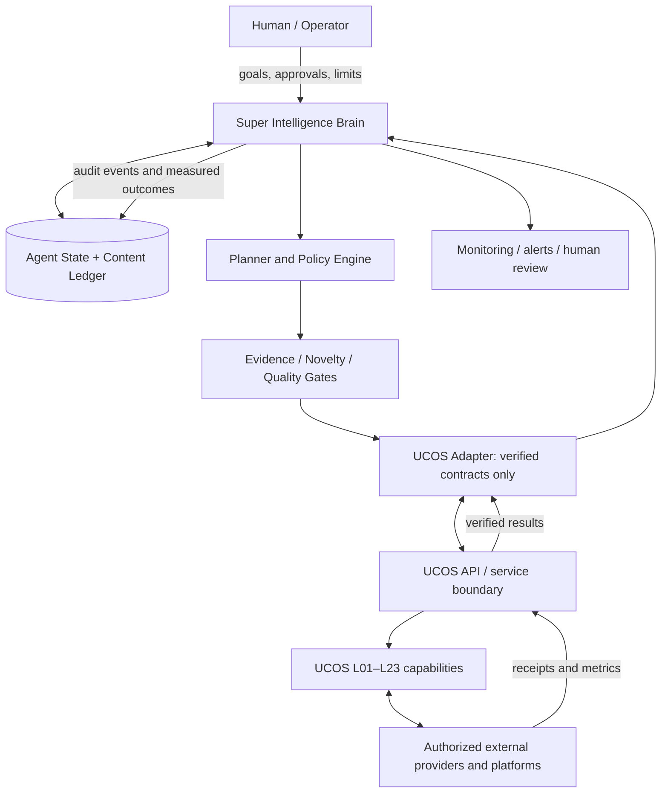
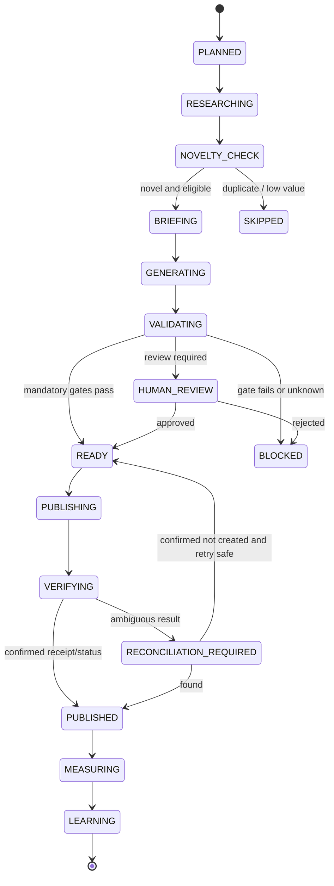

# Super Intelligence Agent — Frozen Architecture v1.0

**Status:** FROZEN — architecture decisions locked; implementation and runtime capabilities are not certified by this document.  
**Architecture ID:** SIA-ARCH-1.0  
**Owner:** UCOS architecture registry  
**Integration target:** `shehrozali6465372-ctrl/universal-content-operating-system`  
**Registry role:** normative architecture decision record for the Super Intelligence Agent.  
**Change policy:** any structural change requires a versioned Architecture Decision Record (ADR), impact analysis, and explicit approval. Bug fixes and implementation details that preserve these invariants do not require a new architecture version.

> This document freezes the intended architecture, not an assertion that every endpoint, provider, account, layer, or deployment is live. UCOS source code and runtime evidence remain authoritative. Where a capability or API contract has not been verified, it is marked **UNVERIFIED** and must not be fabricated by an adapter.

## 1. Mission and governing decision

Build one central, persistent **Super Intelligence Brain** that behaves as an operational decision-maker for content and affiliate workflows. It decides what should happen next, why, for which platform/account/niche, and whether it is safe to proceed. UCOS's 23 layers are specialized execution capabilities/tools the Brain invokes; the layers do not each become autonomous agents merely because they are layers.

The Brain owns orchestration and decision policy. UCOS owns its existing execution capabilities, service contracts, platform adapters, security boundaries, and operational controls. The Brain must not duplicate UCOS functionality or bypass its published interfaces.

### Frozen top-level choices

1. **One central Brain/control loop**, not 23 independent layer agents and not a separately trained model per account.
2. **23 UCOS layers remain bounded capabilities/tools.** Call only verified contracts; an absent endpoint is a gap to document, not an invitation to invent a URL.
3. **Persistent, shared application architecture with strict context isolation.** One logical PostgreSQL-backed source of truth for agent state may serve the Brain; every business record and retrieval is scoped by tenant/workspace/brand/platform/external account/niche as applicable. Shared infrastructure never means shared unfiltered memory.
4. **Account-scoped execution contexts** are created per (platform, external account, niche/workspace). These are configurations and isolated memory/query scopes, not independently trained agents.
5. **Evidence before action.** Planning, publishing, learning and forecasting retain evidence, provenance, timestamps, confidence, and uncertainty.
6. **Fail closed on uncertain external mutations.** Never retry a possibly successful publish blindly; reconcile against UCOS/provider state first.
7. **No secret material in source or registry.** OAuth credentials, access/refresh tokens, API keys and database URLs belong in managed runtime secrets.
8. **Production status is evidence-driven.** A design, mock, passing unit test, or source file alone does not prove provider access or production readiness.

## 2. System context



The diagram expresses logical boundaries, not a claim that every box is currently deployed as a separate service. The implementation may be modular within existing services where that best fits the verified UCOS topology.

## 3. Responsibilities and ownership

### Super Intelligence Brain owns

- Goal interpretation and prioritization across configured accounts/niches.
- Daily/periodic plan generation and task selection.
- State-machine transitions, task scheduling intent, dependency ordering and stop/review decisions.
- Context assembly from scoped history, evidence, analytics, constraints and account configuration.
- Novelty/duplicate decision policy across prior plans, generated assets, scheduled items and confirmed publications.
- Candidate ranking and rationale for topics/products/creative approaches.
- Structured briefs for text, image, video and platform-specific variants.
- Orchestration of quality, policy, factuality, affiliate-disclosure and authorization gates.
- Outcome diagnosis, experiment proposals and evidence-gated strategy updates.
- Audit correlation, budget/cost limits and human-approval requests.

### UCOS owns

- Execution of its layer capabilities through actual supported contracts.
- Provider/model routing, media generation, quality controls, publishing adapters, persistence services and security enforcement where implemented.
- Platform/provider authentication and mutation semantics within the responsible integration boundary.
- Normalized results and evidence that UCOS can actually obtain.
- Runtime health, deployment, migrations and service-level observability.

### Explicit non-goals

- The Brain does not rewrite its own production code or autonomously alter its own permissions.
- It does not bypass UCOS to write directly into UCOS-owned tables.
- It does not assume access to private platform metrics, affiliate conversion data, account credentials, or a product catalog unless the corresponding authorized connector returns evidence.
- It does not promise reach, views, rankings, clicks, sales, or revenue.
- It does not create a separate model-training job for every account.
- It does not treat all 23 layer labels as independently deployed microservices unless implementation evidence confirms that topology.

## 4. UCOS layer tool map

The Brain routes tasks to the relevant UCOS capability through the verified adapter/API boundary. The table describes intended responsibility alignment, not proof of a callable endpoint.

| Layer | Intended capability available to orchestration | Required contract/evidence |
|---|---|---|
| L01 | Foundational configuration, state, memory and scheduling support | Verify callable interface and ownership before use |
| L02 | Research inputs, sources, trends and provenance | Source records, timestamps, retrieval limits |
| L03 | Intelligence: niche, keywords, intent, entities, audience fit and evidence bundles | Structured output and confidence/provenance |
| L04 | Writing plans, drafts, variants, CTA and copy | Input/output schema and generation provenance |
| L05 | Image generation/orchestration and asset provenance | Provider readiness, dimensions, asset URI/checksum |
| L06 | Quality, factuality, originality, safety and compliance gates | Explicit pass/fail/review result and reasons |
| L07 | Platform publishing, result receipt and reconciliation boundary | Verified mutation contract, idempotency and provider status |
| L08 | Analytics ingestion and normalization | Metric definitions, account/post identity, observation time |
| L09 | Learning from observed outcomes and improvement proposals | Evidence-backed result and bounded update interface |
| L10 | Affiliate/product/program eligibility and attribution inputs | Product/program evidence, link provenance, eligibility status |
| L11 | External provider integration boundary | Supported provider contracts and auth lifecycle |
| L12 | Model/provider routing and usage/failure handling | Provider availability, limits and cost/usage evidence |
| L13 | Persistence boundary | Schema/API ownership and durable-write semantics |
| L14 | Enterprise integration, request correlation and idempotency boundaries | Correlation identifiers and duplicate-request behavior |
| L15 | Async execution, retries, cancellation and dead-letter handling | Durable task semantics and retry classification |
| L16 | Database safeguards: transactions, queries, pools and migrations | Migration/test evidence and operational configuration |
| L17 | Security, credentials, threat controls and tool safety | Authorization tests and secret-handling controls |
| L18 | Health, telemetry, dependency status and recovery visibility | Runtime signals and actionable alerts |
| L19 | Analytics engine, recommendations and forecasting | Separate observed facts from estimates |
| L20 | Image pipeline, asset validation and multimodal provenance | Asset validation and real provider evidence |
| L21 | Build, deployment, readiness and recovery | Deployment evidence and reproducible release |
| L22 | Contracts, architecture decisions, documentation and runbooks | Versioned docs and change history |
| L23 | Website management and website-facing operations | Verified site/provider/account status |

**Contract rule:** adapter methods must be backed by repository code, OpenAPI/contract tests, or verified runtime evidence. If no contract exists, return a typed `UNSUPPORTED`/ `UNVERIFIED` result and open an implementation task; do not silently synthesize an endpoint.

## 5. Account, workspace and memory isolation

Each work item carries an explicit scope object. Required fields depend on the operation, but must be validated before any read or write.

```json
{
  "tenant_id": "required-when-multi-tenant",
  "workspace_id": "workspace identifier",
  "brand_id": "brand identifier",
  "platform": "pinterest",
  "external_account_id": "provider-owned account id",
  "niche_id": "home-decor",
  "correlation_id": "traceable-run-id"
}
```

These values are illustrative identifiers, not actual account IDs.

Isolation invariants:

- Never infer an account from a display name alone; use the stable external account ID plus authorized connection record.
- Every content ledger query, duplicate check, plan, publication receipt and analytics row is scoped to the correct platform/account/niche and tenant/workspace where applicable.
- Cross-account sharing is opt-in and limited to explicitly approved, non-sensitive reusable knowledge such as a generic successful content pattern. Credentials, account-private analytics, drafts and unpublished strategy remain isolated.
- Apply authorization in the data-access layer and tool adapter, not only in prompts.
- Tests must attempt cross-account reads/writes and prove denial.
- One shared PostgreSQL deployment is allowed; per-account database instances are not required by this architecture.

## 6. Persistent state and source of truth

Use the existing approved UCOS persistence/API contracts for UCOS-owned data. Agent-owned operational state may live in an agent-owned schema/database, preferably PostgreSQL, without direct writes into UCOS internals. The logical data model must cover:

- **agent_contexts:** configured scope, goals, timezone, enabled platforms, limits, approval mode, strategy version and lifecycle.
- **runs:** run ID, scope, start/end time, trigger, status, correlation ID and summary.
- **tasks:** task ID, scope, type, dependency IDs, status, due time, retry metadata, idempotency key and result reference.
- **content_ledger:** planned/draft/scheduled/published content, normalized text fingerprints, semantic fingerprints, asset checksums, topic/product identity, platform/account, state and provenance.
- **publication_attempts:** task ID, idempotency key, request fingerprint, provider/UCOS receipt, external post ID/URL, attempt status and reconciliation evidence.
- **assets:** content hash, storage URI, media type, dimensions, prompt/brief version, generation provider/model, validation and rights/provenance evidence.
- **product_evidence:** product identity, source URL, observed price/availability/time, affiliate program eligibility, canonical affiliate URL evidence and confidence.
- **analytics_snapshots:** platform/account/post identity, metric name/value/unit, observed-at time, ingestion time and source.
- **experiments:** hypothesis, primary metric, treatment/control definition, scope, sample plan, decision threshold and status.
- **learning_records:** evidence set, baseline, sample size, effect estimate, uncertainty, decision and rollback criteria.
- **strategy_versions:** versioned strategy configuration and change rationale.
- **audit_events:** actor/tool, scope, correlation ID, action, decision rationale summary, evidence references, result and timestamps; never raw secrets.

Schema names above are logical entities. Actual physical table names and migration strategy are implementation decisions within the frozen boundaries.

### Persistence guarantees

- Durable task state is committed before work is acknowledged as queued.
- Idempotency keys are unique within their defined scope and action.
- Use transaction/outbox or an equivalent durable handoff where database writes and queue publication must remain consistent.
- Retain enough request/result metadata to reconcile after a crash, without storing credentials or unnecessarily sensitive payloads.
- Use UTC timestamps for storage and an explicit account timezone for planning calendars.
- Deletion, retention, export and backup requirements must be documented for user/account data.

## 7. Decision loop: observe → decide → act → verify → learn

1. **Observe:** load authorized account configuration, goals, current schedule, pending tasks, prior content, asset ledger, product evidence, policy versions and analytics snapshots.
2. **Check health and authorization:** stop or defer if required service/provider/account permissions are missing, expired or uncertain.
3. **Research:** collect time-stamped sources and candidate topics/products. Store provenance and distinguish verified facts from model-generated hypotheses.
4. **Plan:** rank candidate actions against audience relevance, freshness, goal fit, expected utility, cost, risk, platform limits and current strategy.
5. **Novelty check:** compare against published, scheduled, in-flight and prior content for the same scope. Check exact text/media hashes, normalized text and semantic similarity; also check near-duplicate creative concepts and product/topic repetition windows.
6. **Decide:** choose `PROCEED`, `REVISE`, `DEFER`, `SKIP`, or `HUMAN_REVIEW`, recording evidence and concise rationale.
7. **Build briefs:** generate versioned, structured text/media briefs with target platform, dimensions/aspect ratio, composition, accessibility, disclosure, claims constraints and product-link requirements.
8. **Generate through UCOS:** call only supported L04/L05 and related contracts. Record asset IDs, checksums, model/provider metadata and provenance.
9. **Validate:** require applicable L06/quality/policy checks, factual evidence, originality/duplicate checks, platform formatting and affiliate disclosures. A failed or unknown mandatory gate blocks publication.
10. **Authorize mutation:** confirm correct account, current token/permissions, rate/budget limits, platform-specific requirements and approval mode.
11. **Publish once:** issue a durable idempotent publish command through the verified L07 boundary. Store attempt before or atomically with dispatch as supported by the execution architecture.
12. **Reconcile:** if the request times out or response is ambiguous, query status by idempotency/correlation/provider identifiers before any retry. Do not assume timeout means failure.
13. **Verify:** require provider/UCOS receipt or a later status read. Record published state only with evidence; otherwise retain `UNKNOWN`/ `RECONCILIATION_REQUIRED`.
14. **Measure:** ingest analytics only when available and authorized. Preserve source, metric definition and observation window; do not fill unavailable metrics with invented zeroes.
15. **Learn:** compare outcomes with a relevant baseline, account for sample size and confounders, store uncertainty and propose bounded strategy changes. Keep strategy updates versioned and reversible.



All transitions must be explicit and persisted. Illegal transitions are rejected. Terminal `BLOCKED` and `SKIPPED` states preserve reasons.

## 8. Ranking and planning policy

Use a configurable, evidence-backed candidate score rather than hard-coded claims about guaranteed performance. Candidate features can include audience/niche fit, source freshness, novelty, observed historical performance, product/program eligibility, estimated economic value, production cost, policy risk and platform constraints.

`score = weighted_utility(features, current_strategy_version)`

Requirements:

- Each feature includes its source, timestamp and uncertainty.
- Missing data is represented as missing/unknown, not silently imputed as favorable.
- Hard constraints (permissions, policy, product eligibility, duplicate block, daily quota, cost ceiling) are gates, not weights that can be outweighed by a high score.
- Weights and thresholds are versioned configuration; changes require audit evidence.
- A cold-start account uses conservative defaults and exploration with low cost, not false confidence.
- Respect content cadence, timezone, platform limits and minimum spacing rules per configured account.
- If all candidates fail gates, produce a reasoned no-publish decision rather than forcing content.

## 9. Duplicate and novelty control

Novelty is a multi-signal decision, not one similarity number.

- Exact text: canonicalization plus cryptographic hash.
- Media: cryptographic content hash and, where supported, perceptual hash.
- Semantic text: embedding similarity or another verified semantic matcher.
- Concept level: topic, angle, claim, audience intent, product and call-to-action.
- Schedule collision: check planned, queued, in-flight, recently published and provider-confirmed posts.
- Platform/account history: configurable repetition windows, with cross-platform reuse governed by separate adaptation rules.

A similarity threshold is a calibrated configuration value, not a universal constant. Test it against labeled examples and record false-positive/false-negative rates. A high score triggers revision or review, not automatic deletion of history. Exact duplicate of an already published or in-flight item blocks a second publish unless a documented, authorized repost operation explicitly permits it.

## 10. Product and affiliate evidence

Before including an affiliate product or link:

- Verify product identity from an authorized source and record when the evidence was observed.
- Verify current program eligibility and the actual affiliate URL using the authorized program workflow.
- Validate that redirects resolve safely, the destination is relevant, and the link is not malformed or stale. Do not bypass platform or affiliate-program rules.
- Keep product price, availability, commission, claims and URL provenance separate; these fields can expire at different rates.
- Do not invent a product, commission, stock status, review, discount, claim or affiliate link.
- Include required affiliate disclosures in the relevant creative/caption/landing context.
- If evidence is stale or eligibility is unknown, refresh it or block the monetized action.

## 11. Learning, experimentation and forecasting

- Store observations separately from hypotheses and predictions.
- Compare like with like: same account/platform, comparable content class, exposure window and metric definition where possible.
- Record sample size, baseline, uncertainty, effect size, data quality and confounders.
- Do not promote a tactic based on one viral post or low-volume noisy data.
- Prefer controlled experiments where feasible; change one primary variable at a time when attribution matters.
- A learned rule is a versioned proposal until it passes a configurable evidence threshold and policy review.
- Keep rollback to the prior strategy version available.
- Forecasts must include horizon, assumptions, interval/uncertainty and evidence date. Never represent forecast metrics as observed facts or guarantee traffic/revenue.

## 12. Safety, approvals and external side effects

Mandatory pre-mutation gates:

- Valid authorization for the exact platform/external account.
- Correct scope and tenant/workspace isolation.
- Content quality, factuality, safety and applicable platform policy checks.
- Originality/duplicate check.
- Affiliate disclosure and product/link evidence when monetized.
- Rate limits, daily cadence, budget and model/provider limits.
- Human approval when required by account configuration, low confidence, sensitive claims, policy ambiguity or a high-impact action.

External side effects are deny-by-default when a required gate is unavailable. Manual approval must bind to the exact content/asset hashes, target account, destination/link and policy version; edits after approval invalidate approval and require revalidation.

## 13. Security and trust boundaries

- Least-privilege machine identity for the Brain; separate permissions for read, draft, approve and publish where supported.
- Secrets live in runtime secret storage. Never commit, log, embed in prompts or expose tokens to model context unless strictly required and protected.
- Validate all tool arguments and provider responses with schemas; treat external pages, product descriptions, uploaded content and model outputs as untrusted data.
- Defend against prompt injection, SSRF, malicious URLs, unsafe file types, replay, cross-tenant access, credential leakage and tool misuse.
- Use TLS for network calls, bounded timeouts, response-size limits, redaction and safe error messages.
- Record immutable or tamper-evident audit events where available. Logs must not include raw secrets or unnecessary personal data.
- Use a kill switch to stop new mutations, revoke/disable account contexts, and pause a provider independently.
- Human approvals and platform consent remain authoritative; the agent cannot expand its own scope.

## 14. Reliability and operations

- Durable tasks with bounded retries, exponential backoff plus jitter for transient failures, and no retry for non-retryable policy/auth/validation errors without remediation.
- Circuit breakers and provider-specific rate limiting where appropriate.
- Explicit timeout, cancellation, dead-letter and manual-replay policies.
- Reconciliation workers for ambiguous publishing attempts.
- Health checks distinguish process health, database health, UCOS contract reachability, provider authorization and real provider readiness.
- Correlation IDs follow a task across Brain, adapter, UCOS and provider boundary.
- Metrics include queue age, task outcomes, retry rate, reconciliation backlog, duplicate blocks, gate failures, provider error class, model usage/cost and latency.
- Alerts focus on actionable failures, expired authorization, repeated publish ambiguity, database/queue failure and unexpected spend.
- Recovery runbooks must document how to pause, reconcile, resume and restore from backups.

## 15. Observability and decision audit

Every decision should be reconstructable without storing private chain-of-thought. Record a concise rationale and references to evidence, not hidden internal reasoning traces.

Minimum audit fields: timestamp; run/task/correlation IDs; scope identifiers; action and state transition; strategy/policy version; evidence/source IDs; gate outcomes; adapter contract/version; redacted request fingerprint; result classification; external receipt; retry/reconciliation history; estimated/actual cost where known.

Operational dashboards must distinguish:
- observed vs inferred vs forecast values;
- source-code capability vs integration-ready vs live-verified capability;
- planned vs attempted vs confirmed-published content;
- unavailable metrics vs observed zero metrics.

## 16. Cost and model routing

- Route tasks to the least-cost model/provider that meets the quality, modality and policy requirements.
- Set per-run, per-account and global budget limits.
- Limit generation variants and use cheap deterministic checks before expensive model calls.
- Cache reusable research only with explicit freshness and scope metadata.
- Track token/image/video usage and provider errors.
- Stop or request approval when budget is exhausted; do not silently fall back to an unapproved provider.
- Provider routing decisions are configuration and operational policy, not changes to the frozen architecture.

## 17. Testing and release gates

Required verification before enabling external publishing:

1. Unit tests for planner, scope enforcement, state machine, scoring, schema validation, idempotency and duplicate detection.
2. Contract tests for each UCOS adapter method against real published schemas or verified implementations.
3. Negative tests for expired credentials, unsupported endpoints, policy failure, malformed output, duplicate content and budget exhaustion.
4. Isolation tests that attempt cross-tenant/account reads, writes and memory retrieval.
5. Fault-injection tests for timeout before send, timeout after provider mutation, duplicate response, queue redelivery, worker crash and database outage.
6. Reconciliation tests proving no duplicate publish after ambiguous outcomes.
7. End-to-end test with a non-production or explicitly approved test account; preserve evidence and avoid unauthorized public posts.
8. Human-review and kill-switch tests.
9. Migration, backup/restore, secret redaction and alert delivery tests.
10. Pilot rollout with one explicitly configured platform/account/niche; scale only after evidence-backed acceptance.

### Acceptance criteria

- No external mutation without all mandatory gates passing.
- No duplicate publish caused by retry or queue redelivery in tested failure scenarios.
- Every content decision and mutation is linked to a durable task and audit event.
- Account/tenant scope is enforced and negative isolation tests pass.
- Unknown API contracts fail explicitly without fabricated calls.
- Provider/auth status is reported accurately; mocks cannot be labeled LIVE.
- Observed metrics, estimates and forecasts remain distinguishable.
- Strategy changes are versioned, explainable and reversible.
- Cost limits, kill switch and human approval gates are operationally tested.
- Deployment and provider readiness are certified separately from architecture approval.

## 18. Implementation sequence (architecture remains frozen)

**Phase 0 — Contract inventory:** map each required Brain operation to a real UCOS API/module and record request/response schemas, auth, idempotency and tests. Mark gaps UNVERIFIED.

**Phase 1 — Read-only Brain:** configure scoped contexts; load authorized history; build ledger, planner, novelty check and audit trail. No external mutations.

**Phase 2 — Draft mode:** generate research-backed plans and briefs; execute text/media generation only through verified contracts; run quality gates and human review.

**Phase 3 — Supervised publishing:** enable one authorized test/pilot account after contract, idempotency, authorization and reconciliation tests pass. Require human approval.

**Phase 4 — Verified analytics and learning:** ingest only accessible metrics, normalize their definitions, establish baselines and propose controlled experiments.

**Phase 5 — Gradual scale:** enable additional account contexts/platforms after isolation, cost, reliability and policy evidence passes. Do not duplicate Brain logic per account.

## 19. Frozen decisions vs configurable implementation

### Frozen (requires ADR/version change to alter)

- One central Super Intelligence Brain/control loop.
- UCOS's 23 layers are execution capabilities/tools, not 23 autonomous agents.
- Existing UCOS remains the execution/source-of-truth boundary; use verified contracts and do not bypass security.
- Shared PostgreSQL-backed agent state is permitted with strict scoped isolation and clear data ownership.
- Logical context per platform + external account + niche/workspace; no separately trained model per account requirement.
- Evidence/provenance-first decisions, explicit state machine, idempotent mutation, reconciliation after ambiguous outcomes, quality/policy gates, auditability and reversible learning.
- No secret material in source or architecture registry.
- Unknown/unverified status is never promoted to live/verified without evidence.

### Configurable without changing architecture version

- Model/provider choice and routing.
- Similarity thresholds, scoring weights, cadence and freshness windows.
- Budget ceilings, retry counts, timeout values and queue implementation.
- Supported platform list and account-specific goals.
- Approval mode and policy thresholds within authorized governance.
- Physical database schema, deployment topology and framework, provided the frozen invariants and verified UCOS boundaries are preserved.

## 20. Architecture change and freeze governance

Any proposal that changes a frozen decision must include:

1. A new ADR with motivation, alternatives, decision and consequences.
2. Data/security/operational migration and backward-compatibility impact.
3. Affected UCOS layers, contracts, ownership and source files.
4. Failure-mode, recovery, cost and provider-policy analysis.
5. Test plan and objective acceptance criteria.
6. Explicit approval before updating this frozen document.

Implementation status may evolve without changing this architecture. Record status/evidence in the appropriate registry operational files; do not edit the frozen decision in place to make status appear more complete.

## 21. Source-of-truth and verification references

- UCOS implementation: https://github.com/shehrozali6465372-ctrl/universal-content-operating-system
- UCOS architecture registry: https://github.com/shehrozali6465372-ctrl/ucos-architecture-registry
- UCOS master architecture in this registry: `architecture/UCOS_MASTER_ARCHITECTURE.md`
- Pinterest developer documentation: https://developers.pinterest.com/docs/
- TikTok developer documentation: https://developers.tiktok.com/
- Meta developer documentation: https://developers.facebook.com/docs/

Platform API behavior, scopes, quotas and endpoint versions must be rechecked against current official documentation when the corresponding adapter is implemented. This architecture intentionally avoids treating illustrative provider payloads as verified UCOS contracts.

---

**Freeze statement:** SIA-ARCH-1.0 is the canonical structural baseline for the Super Intelligence Agent. Freeze applies to the architecture decisions above; it does not certify implementation completeness, external provider access, account authorization, production deployment, or revenue outcomes.
